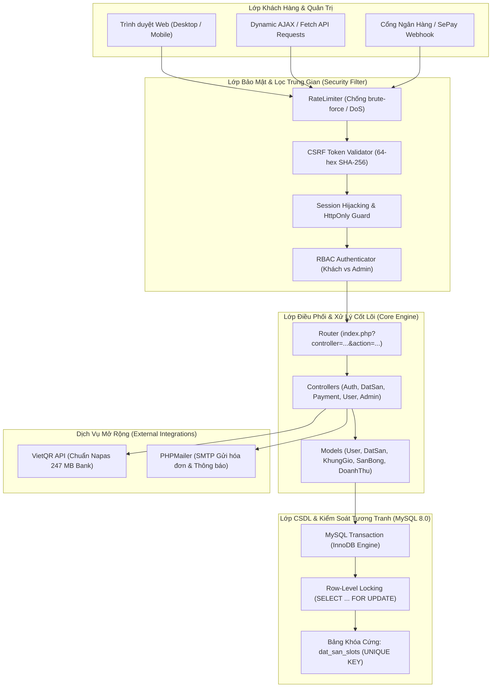
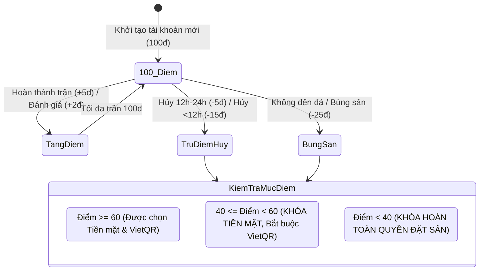
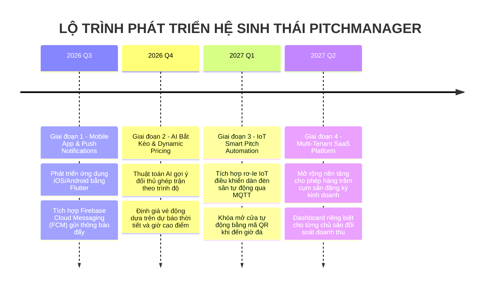

# 🏟️ PitchManager - Hệ Thống Quản Lý & Đặt Sân Bóng Đá Phủi Đà Nẵng
> **Nền tảng chuyển đổi số toàn diện cho chuỗi sân bóng đá mini & phủi tại Thành phố Đà Nẵng.**  
> Xây dựng theo kiến trúc **Pure PHP MVC (Model-View-Controller thuần)**, tối ưu hiệu năng vượt trội, kiểm soát tương tranh mức hàng (Row-Level Locking), bảo mật đạt chuẩn OWASP Top 10 và tích hợp quy trình kiểm thử tự động đa tầng tiêu chuẩn công nghiệp.

---

[](https://www.php.net/)
[](https://www.mysql.com/)
[](https://en.wikipedia.org/wiki/Model%E2%80%93view%E2%80%93controller)
[](https://phpunit.de/)
[](https://playwright.dev/)
[](https://www.postman.com/)
[](https://jmeter.apache.org/)
[](https://owasp.org/)
[](LICENSE)

---

## 📌 MỤC LỤC TỔNG QUAN

1. [Bối Cảnh Thực Tế & Bài Toán Nghiệp Vụ](#-1-bối-cảnh-thực-tế--bài-toán-nghiệp-vụ)
2. [Kiến Trúc Hệ Thống & Giải Pháp Kỹ Thuật](#-2-kiến-trúc-hệ-thống--giải-pháp-kỹ-thuật)
3. [Danh Sách 14 Chức Năng Cốt Lõi](#-3-danh-sách-14-chức-năng-cốt-lõi)
4. [Các Cơ Chế Nghiệp Vụ & Thuật Toán Chuyên Sâu](#-4-các-cơ-chế-nghiệp-vụ--thuật-toán-chuyên-sâu)
5. [Đánh Giá Kỹ Thuật: Ưu Điểm & Thế Mạnh Cốt Lõi](#-5-đánh-giá-kỹ-thuật-ưu-điểm--thế-mạnh-cốt-lõi)
6. [Đánh Giá Kỹ Thuật: Nhược Điểm & Giới Hạn Hiện Tại](#-6-đánh-giá-kỹ-thuật-nhược-điểm--giới-hạn-hiện-tại)
7. [Định Hướng Phát Triển Tương Lai (Roadmap 2026 - 2027)](#-7-định-hướng-phát-triển-tương-lai-roadmap-2026---2027)
8. [Cấu Trúc Thư Mục & Vai Trò Thành Phần](#-8-cấu-trúc-thư-mục--vai-trò-thành-phần)
9. [Hệ Thống Kiểm Thử Phần Mềm Chuyên Nghiệp](#-9-hệ-thống-kiểm-thử-phần-mềm-chuyên-nghiệp)
10. [Hướng Dẫn Cài Đặt, Triển Khai & Vận Hành](#-10-hướng-dẫn-cài-đặt-triển-khai--vận-hành)
11. [Tác Giả & Bản Quyền](#-11-tác-giả--bản-quyền)

---

## ⚽ 1. BỐI CẢNH THỰC TẾ & BÀI TOÁN NGHIỆP VỤ

### 1.1. Thực trạng quản lý sân bóng phủi tại TP. Đà Nẵng
Đà Nẵng là đô thị năng động với phong trào bóng đá phủi (sân cỏ nhân tạo 5 người và 7 người) phát triển vượt bậc trải dài tại các quận Hải Châu, Thanh Khê, Liên Chiểu, Cẩm Lệ, Sơn Trà, Ngũ Hành Sơn. Tuy nhiên, quy trình vận hành tại phần lớn cụm sân thể thao hiện nay vẫn mang tính tự phát và thủ công:
* **Ghi chép sổ sách hoặc tin nhắn Zalo:** Dễ xảy ra sai sót thất lạc thông tin, quản lý rời rạc giữa ca làm việc của các nhân viên.
* **Vấn nạn "Bùng sân" (No-Show):** Khách đặt miệng qua điện thoại nhưng sát giờ không đến đá hoặc hủy đột ngột khiến sân bị bỏ trống trong khung giờ vàng (17h30 - 20h30), gây thất thoát tài chính nặng nề cho chủ sân mà không có cơ chế chế tài.
* **Trùng lịch (Double-Booking):** Khi 2 nhân viên cùng nhận cọc hoặc 2 khách hàng cùng liên hệ chốt một khung giờ, xung đột tranh chấp sân thi đấu thường xuyên diễn ra.
* **Xung đột ghép sân 5 & sân 7:** Phần lớn các sân 7 người phong trào tại Việt Nam được ghép từ 2 sân 5 con cạnh nhau (ngăn cách bởi hệ thống lưới kéo di động). Khi cho thuê sân 7 nhưng nhân viên bất cẩn vẫn cho thuê 1 trong 2 sân con, dẫn đến tình huống bất khả thi khi trận đấu diễn ra.
* **Thanh toán thủ công sai lệch:** Nhập tay số tiền hoặc nội dung chuyển khoản ngân hàng khiến chủ sân mất nhiều thời gian đối soát từng giao dịch tài chính.

### 1.2. Mục tiêu chiến lược của dự án PitchManager
Hệ thống **PitchManager** được thiết kế để giải quyết triệt để toàn bộ các nút thắt trên thông qua tự động hóa phần mềm:
- **Tự động hóa giữ chỗ & đặt sân 24/7:** Người chơi có thể tự tra cứu lịch, xem sơ đồ mặt bằng 2D và giữ chỗ trực tuyến mọi lúc mọi nơi.
- **Khóa dòng dữ liệu chống trùng tuyệt đối:** Ứng dụng khóa mức hàng CSDL bảo đảm tính toàn vẹn ngay cả khi có hàng nghìn yêu cầu cùng gửi đến tại cùng một mili-giây.
- **Khóa chéo đa năng hai chiều (Compound Pitch Locking):** Tự động đồng bộ trạng thái giữa sân 7 và cụm sân 5 con thành phần.
- **Thanh toán VietQR chuẩn Napas 247 kết hợp Webhook:** Tự động sinh mã QR đúng từng chữ số, tích hợp Webhook ngân hàng tự động đối soát và chốt đơn theo thời gian thực (Zero human latency).
- **Hệ thống Điểm Uy Tín & Chế tài bùng sân:** Tự động hóa phân loại rủi ro khách hàng theo thang điểm 100, bảo vệ nguồn thu tài chính cho chủ sân.

---

## 🏛️ 2. KIẾN TRÚC HỆ THỐNG & GIẢI PHÁP KỸ THUẬT

### 2.1. Triết lý thiết kế: Pure PHP MVC & RESTful API
Hệ thống tuân thủ nghiêm ngặt mô hình **Model-View-Controller (MVC) thuần** trên nền tảng **PHP 8.2+**:
- **Không phụ thuộc Framework cồng kềnh:** Giảm thiểu tối đa overhead bộ nhớ, thời gian phản hồi (TTFB) đạt mức cực thấp (< 25ms), không bị ảnh hưởng bởi lỗi tương thích phiên bản của bên thứ ba.
- **RESTful Endpoints & Hybrid Architecture:** Cung cấp đầy đủ các Controller xử lý luồng View HTML truyền thống kết hợp các API JSON hỗ trợ AJAX/Fetch thời gian thực (tra cứu lịch động, kiểm tra tình trạng thanh toán Polling, tiếp nhận Webhook ngân hàng SePay).
- **Phân tách giao diện nghiêm ngặt (0% Inline Code):** Toàn bộ CSS/JS được phân tách thành các module riêng biệt trong `assets/` và `admin/`, giao tiếp dữ liệu thông qua Data Attributes và Fetch API.

### 2.2. Sơ đồ kiến trúc tổng thể (Architecture Diagram)



---

## 📋 3. DANH SÁCH 14 CHỨC NĂNG CỐT LÕI

Hệ thống cung cấp đầy đủ 14 chức năng hoàn chỉnh phân định rõ giữa hai phân hệ **Khách Hàng (Client)** và **Quản Trị Viên (Admin)**:

| STT | Tên Chức Năng | Phân Hệ | Mô Tả Tóm Tắt | Công Nghệ Áp Dụng |
| :---: | :--- | :---: | :--- | :--- |
| **01** | **Đăng ký / Đăng nhập / Đăng xuất** | Client | Xác thực tài khoản bằng SĐT Việt Nam hợp lệ; mật khẩu băm BCRYPT; kiểm tra nhị phân `BINARY` phân biệt hoa/thường; tái tạo Session ID và hủy phiên triệt để khi đăng xuất. | PHP 8.2 `password_hash`, Regex VN Phone, Binary SQL |
| **02** | **Tìm kiếm và Lọc sân bóng** | Client | Tìm kiếm thời gian thực (Debounce Search 300ms) theo tên và địa chỉ không tải lại trang; bộ lọc nâng cao đa tiêu chí theo loại sân (5 hoặc 7) và thanh trượt khoảng giá thuê. | AJAX Fetch API, Debounce Pattern, SQL Dynamic Filter |
| **03** | **Xem sân, Tra cứu lịch & Sơ đồ 2D** | Client | Bản đồ sân bóng 2D hiển thị trực quan 3 màu trạng thái: Xanh (Trống), Vàng (Đang giữ chỗ), Đỏ (Đã đặt); tra cứu lịch linh hoạt theo ngày (chặn ngày quá khứ); khoảng đệm 5 phút chuẩn bị sân (Lead Time Buffer) tự động vô hiệu hóa các khung giờ đã trôi qua. | SVG/Canvas 2D CSS Grid, Lead Time Buffer, AJAX Datepicker |
| **04** | **Đặt sân và Chống trùng (Double-Booking)** | Client | Khóa giao dịch cấp CSDL (`SELECT ... FOR UPDATE`) kết hợp ràng buộc `UNIQUE KEY active_key` trên bảng `dat_san_slots`; cơ chế giữ chỗ 10 phút chuyển màu ô sân sang vàng và tự động nhả về xanh nếu quá hạn chưa thanh toán. | MySQL Transaction, Row-Level Locking, Auto-Cancel Timer |
| **05** | **Ghép sân 5 và 7 (Khóa chéo đa năng)** | Client | Thuật toán đồng bộ trạng thái hai chiều giữa sân lớn và các sân nhỏ thành phần: đặt Sân 7 tự động khóa đồng thời cả 2 sân 5 con (5A, 5B) ở cùng khung giờ; ngược lại nếu 1 sân 5 đã có người đặt thì tự động vô hiệu hóa đặt Sân 7 tương ứng. | Relational Compound Mapping, Cross-Locking Validator |
| **06** | **Thanh toán Tiền mặt & VietQR Napas 247** | Client | Tạo động mã VietQR chuẩn Napas 247 (Ngân hàng MB Bank) tự điền số tài khoản, số tiền và cú pháp `DATSAN <id>`; tích hợp Webhook SePay tự động bắt giao dịch ngân hàng và chốt đơn tức thì theo thời gian thực (hỗ trợ Polling trạng thái live). | VietQR Napas 247, SePay Webhook, Realtime Polling JS |
| **07** | **Điểm uy tín và Chế tài bùng sân** | Client | Thang điểm chuẩn [0, 100]; hoàn thành trận đá cộng +5đ (tối đa 100đ); gửi đánh giá cộng +2đ; đánh dấu bùng sân trừ thẳng -25đ; điểm < 60đ tự động khóa thanh toán tiền mặt; điểm < 40đ khóa hoàn toàn quyền đặt sân. | Credit Score Matrix, Automated Penalty Policy |
| **08** | **Hủy đơn và Hoàn tiền** | Client | Bộ quy tắc phạt điểm hủy sân minh bạch: hủy trước > 24h (không phạt), hủy 12h - 24h (-5đ), hủy < 12h (-15đ); bắt buộc người dùng nhập đầy đủ thông tin STK ngân hàng trước khi xác nhận hủy đơn chuyển khoản; tự động giải phóng slot CSDL. | Dynamic Buffer Validation, Bank Refund State Machine |
| **09** | **ADM Đăng nhập & Phân quyền (RBAC)** | Admin | Kiểm soát truy cập dựa trên vai trò nghiêm ngặt; chặn đứng mọi hành vi truy cập trái phép từ khách vãng lai và người dùng thông thường vào phân hệ quản trị `/admin/`; ghi nhật ký phiên đăng nhập. | Role-Based Access Control (RBAC), Session Verification |
| **10** | **ADM Quản lý Sân bóng & Cấu hình ghép** | Admin | Thêm mới, cập nhật thông tin và xóa sân bóng; cơ chế kiểm tra ràng buộc toàn vẹn ngăn không cho xóa sân đang có lịch đặt chưa hoàn thành; cấu hình quan hệ ghép sân 7 từ 2 sân con 5 tương ứng. | CRUD Operations, Foreign Key Integrity, Sub-pitch Mapping |
| **11** | **ADM Khung giờ và Bảng giá** | Admin | Thiết lập danh mục khung giờ hoạt động; cấu hình giá riêng cho khung giờ vàng cao điểm; áp dụng tỷ lệ/số tiền phụ thu vào ngày cuối tuần (Thứ 7, Chủ Nhật) và biểu giá riêng cho sân 7. | Dynamic Pricing Engine, Weekend Surcharge Calculator |
| **12** | **ADM Quản lý Đặt sân & Hoàn tiền** | Admin | Duyệt đơn hợp lệ, từ chối đơn sai phạm để giải phóng slot, xác nhận thu tiền mặt tại sân, báo bùng sân kích hoạt trừ điểm uy tín; hiển thị mã VietQR chứa sẵn STK của khách để Admin quét hoàn tiền nhanh 1 chạm. | Booking Operations, 1-Click VietQR Refund Modal |
| **13** | **ADM Quản lý Người dùng** | Admin | Tra cứu thông tin khách hàng, xem nhật ký biến động điểm uy tín; can thiệp cộng/trừ điểm thủ công kèm lý do xử lý khiếu nại; khóa và mở khóa tài khoản người dùng vi phạm. | User Auditing, Manual Credit Adjustment, Account Lock |
| **14** | **ADM Báo cáo Doanh thu & Thống kê** | Admin | Lọc doanh thu theo ngày, tuần, tháng (ràng buộc chuẩn hóa mốc $\ge$ 2025-01-01); thống kê tổng doanh thu, số lượt đặt, tỷ lệ lấp đầy; phân tách rõ tiền mặt và VietQR; hỗ trợ xuất báo cáo Excel (.csv UTF-8 BOM). | Analytics Aggregation, Chart.js, UTF-8 BOM CSV Export |

---

## ⚙️ 4. CÁC CƠ CHẾ NGHIỆP VỤ & THUẬT TOÁN CHUYÊN SÂU

### 4.1. Cơ chế chống Race Condition & Đặt trùng sân (Double-Booking)
Để ngăn chặn hoàn toàn tình huống hai hoặc nhiều người dùng cùng nhấn đặt một sân tại cùng một thời điểm, hệ thống triển khai kiến trúc bảo vệ **hai tầng độc lập**:
1. **Tầng Giao dịch CSDL & Khóa mức hàng:**
   ```sql
   START TRANSACTION;
   SELECT dat_san_id, ten_san_con, san_con_khoa 
   FROM dat_san 
   WHERE khung_gio_id = ? AND ngay_dat = ? AND trang_thai NOT IN ('Đã hủy', 'Hủy', 'Chờ hoàn tiền', 'Đã hoàn tiền')
   FOR UPDATE;
   ```
2. **Tầng Ràng buộc CSDL cứng qua bảng `dat_san_slots`:**
   Mỗi đơn đặt sân được ghi nhận đồng thời vào bảng `dat_san_slots` với ràng buộc khóa duy nhất:
   ```sql
   UNIQUE KEY active_key (khung_gio_id, ngay_dat, ten_san_con, trang_thai)
   ```
   Khi một tiến trình cố tình đặt đè lên slot đang có trạng thái `active` hoặc `holding`, MySQL sẽ ném lỗi ngoại lệ vi phạm khóa duy nhất (Duplicate Entry), buộc giao dịch rollback an toàn và báo lỗi thân thiện cho người dùng.

### 4.2. Thuật toán Khóa chéo ghép sân đa năng (Compound Pitch Locking)
Cấu trúc sân bóng phủi cho phép một sân 7 được ghép từ 2 sân 5 con (ví dụ: Sân 7 số 1 ghép từ Sân 5A và Sân 5B):
- **Chiều thuận (Đặt sân 7):** Khi khách đặt thành công Sân 7, hệ thống kiểm tra và xác nhận cả 5A và 5B đều đang trống. Khi giao dịch hoàn tất, hệ thống tự động khóa cả hai sân con `san_con_khoa = 'A,B'` ở khung giờ đó.
- **Chiều nghịch (Đặt sân 5 con):** Nếu Sân 5A hoặc Sân 5B đã có người đặt trước hoặc đang được giữ chỗ, hệ thống tự động vô hiệu hóa tùy chọn Sân 7 tương ứng trên sơ đồ 2D và từ chối mọi yêu cầu đặt sân 7 gửi trực tiếp đến backend.

```
       ┌───────────────────────────────┐
       │     SÂN 7 GHÉP ĐA NĂNG        │
       └──────────────┬────────────────┘
                      │
           ┌──────────┴──────────┐
           ▼                     ▼
    ┌──────────────┐      ┌──────────────┐
    │  SÂN CON 5A  │ ◄──► │  SÂN CON 5B  │
    └──────────────┘      └──────────────┘
    (Nếu 7 được đặt ──► Tự động khóa 5A & 5B)
    (Nếu 5A hoặc 5B có đơn ──► Khóa Sân 7)
```

### 4.3. Khoảng đệm chuẩn bị sân (Lead Time Buffer 5 Phút)
- Nhằm tránh tình trạng khách hàng đặt các khung giờ đã trôi qua hoặc đặt quá sát giờ thi đấu khiến ban quản lý không kịp dọn dẹp hoặc chuẩn bị sân, hệ thống áp dụng khoảng đệm bắt buộc **5 phút**:
  $$\text{slot\_start\_time} \le \text{time}() + 300$$
- Nếu khung giờ vi phạm điều kiện này trong ngày hiện tại, giao diện Frontend sẽ tự động làm mờ và gắn cờ `disabled`. Tại Backend, Controller và Model kiểm tra nghiêm ngặt và từ chối ngay lập tức nếu có request cố tình can thiệp API.

### 4.4. Bộ đếm giữ chỗ 10 phút & Tự động nhả slot (10-Minute Hold & Auto-Release)
- Khi khách hàng nhấn "Đặt sân", hệ thống tạo đơn với trạng thái `Chờ thanh toán` và chuyển ô sân sang **màu vàng (Holding)** trên sơ đồ 2D trong vòng **10 phút** ($600$ giây).
- Khách hàng được hiển thị đồng hồ đếm ngược theo thời gian thực trên trang thanh toán.
- Nếu sau 10 phút khách không hoàn tất thanh toán, hệ thống (thông qua hàm tự động `autoCancelExpiredHolds(10)` được nhúng tại các điểm truy cập lịch, lịch sử đặt sân và cron daemon) sẽ tự động chuyển đơn sang `Đã hủy` và cập nhật `dat_san_slots.trang_thai = 'released'` để nhả sân cho người khác đặt.

### 4.5. Hệ thống Điểm Uy Tín & Ma trận chế tài (Reputation Score Matrix)
Mỗi tài khoản được quản lý điểm tín nhiệm trong khoảng $[0, 100]$ (mặc định 100 điểm khi đăng ký mới):



---

## 💎 5. ĐÁNH GIÁ KỸ THUẬT: ƯU ĐIỂM & THẾ MẠNH CỐT LÕI

1. ⚡ **Hiệu năng siêu tốc & Tiết kiệm tài nguyên phần cứng:**
   - Xây dựng bằng Pure PHP MVC không dùng framework nặng giúp thời gian phản hồi máy chủ (TTFB) chỉ dao động từ **10ms đến 25ms**.
   - Bộ nhớ RAM tiêu thụ cho mỗi tiến trình xử lý dưới **8MB**, cho phép chạy ổn định trên các gói hosting cấu hình thấp hoặc VPS tiết kiệm chi phí.
2. 🔒 **Bảo mật đa tầng theo tiêu chuẩn quốc tế OWASP:**
   - 100% câu lệnh truy vấn dữ liệu sử dụng **Prepared Statements** chống SQL Injection tuyệt đối.
   - Cơ chế bảo vệ **Anti-CSRF Token** 64-hex SHA-256 trên mọi form và request POST.
   - Xác thực đăng nhập nhị phân `BINARY` chống tấn công vượt quyền bằng biến thể chữ hoa/chữ thường.
   - Tích hợp bộ đệm an toàn **IP Rate Limiter** ngăn chặn brute-force và DDoS.
   - Bộ kiểm thử bảo mật tự động đạt **9/9 tiêu chí kiểm toán OWASP**.
3. 🔄 **Xử lý tương tranh & Toàn vẹn dữ liệu xuất sắc:**
   - Cơ chế khóa hàng `SELECT ... FOR UPDATE` và bảng khóa trạng thái `dat_san_slots` đã vượt qua bài kiểm thử tải mô phỏng hàng trăm yêu cầu đặt cùng lúc bằng **Apache JMeter**, chứng minh tỷ lệ trùng lịch bằng **0%**.
4. 💳 **Tự động hóa thanh toán VietQR chuẩn Napas 247:**
   - Không cần đầu tư thiết bị POS đắt đỏ, hệ thống sinh mã VietQR động trực tiếp từ dữ liệu hóa đơn.
   - Webhook SePay hoạt động thông minh, tự động nhận diện và cập nhật trạng thái đơn đặt sân trong tích tắc khi tiền nổi trong tài khoản ngân hàng.
5. 🧪 **Quy trình kiểm thử toàn diện & Độc lập:**
   - Dự án trang bị sẵn thư mục `tester/` với **5 bộ công cụ kiểm thử chuẩn mực** (PHPUnit, Postman, Playwright, Apache JMeter, OWASP Security Auditor), đảm bảo khả năng kiểm chứng chất lượng phần mềm theo tiêu chuẩn giáo trình đại học và doanh nghiệp.

---

## ⚠️ 6. ĐÁNH GIÁ KỸ THUẬT: NHƯỢC ĐIỂM & GIỚI HẠN HIỆN TẠI

Mặc dù hệ thống đã hoạt động hoàn thiện và ổn định, dưới góc độ kỹ sư phần mềm chuyên nghiệp, dự án vẫn có một số giới hạn kỹ thuật cần được ghi nhận:

1. **Phụ thuộc vào Webhook Callback của bên thứ ba khi chạy Localhost:**
   - Khi chạy ở môi trường phát triển cục bộ (`localhost`), máy chủ ngân hàng không thể gửi Webhook trực tiếp tới máy tính cá nhân nếu không có công cụ tạo đường hầm (như Localtunnel hoặc Ngrok).
2. **Chưa hỗ trợ Gateway thanh toán thẻ quốc tế (Visa/Mastercard):**
   - Hiện tại hệ thống tập trung tối ưu cho thị trường bóng đá phủi nội địa Việt Nam qua phương thức **Tiền mặt** và **VietQR (Napas 247)**. Các cổng quốc tế như Stripe hoặc PayPal chưa được tích hợp.
3. **Session lưu trữ mặc định trên File System:**
   - Phiên làm việc (Session) hiện lưu trữ tại thư mục session của máy chủ web đơn lẻ. Khi mở rộng hệ thống lên cụm máy chủ phân tán (Distributed Server Cluster / Load Balancer), cần nâng cấp sang Redis Session Storage.
4. **Chưa đóng gói thành Progressive Web App (PWA):**
   - Giao diện web được tối ưu responsive trên thiết bị di động, nhưng chưa hỗ trợ Service Worker để cài đặt biểu tượng ứng dụng và gửi Web Push Notifications khi không mở trình duyệt.

---

## 🚀 7. ĐỊNH HƯỚNG PHÁT TRIỂN TƯƠNG LAI (ROADMAP 2026 - 2027)

Dự án có tiềm năng mở rộng to lớn để trở thành một hệ sinh thái thể thao số hoàn chỉnh với lộ trình 4 giai đoạn:



* **Giai đoạn 1 (Q3/2026) - Ứng dụng Di động Native (Mobile App):**  
  Phát triển ứng dụng di động cho cầu thủ và chủ sân bằng **Flutter** / **React Native**, tích hợp định vị GPS tìm sân bóng gần nhất và nhận thông báo đẩy tức thì khi đơn được duyệt hoặc sắp đến giờ thi đấu.
* **Giai đoạn 2 (Q4/2026) - AI Ghép Trận & Định Giá Động (AI-Powered Pitch Matching):**  
  Tích hợp mô hình AI phân tích lịch sử thi đấu để tự động gợi ý "bắt kèo", tìm đối tác đá tập cùng trình độ; tự động điều chỉnh biểu giá thuê sân theo thuật toán cung - cầu và dự báo thời tiết thời gian thực.
* **Giai đoạn 3 (Q1/2027) - Tự Động Hóa Phần Cứng IoT (Smart Pitch IoT):**  
  Kết nối hệ thống phần mềm với các thiết bị vi điều khiển ESP32 / Arduino qua giao thức MQTT để tự động bật dàn đèn chiếu sáng đúng giờ đặt và tự động ngắt điện khi hết giờ, loại bỏ hoàn toàn gian lận thời gian đá.
* **Giai đoạn 4 (Q2/2027) - Nền tảng Đa Cụm Sân (Multi-Tenant SaaS):**  
  Nâng cấp kiến trúc cơ sở dữ liệu hỗ trợ Multi-Tenancy, cho phép bất kỳ chủ sân nào trên toàn quốc cũng có thể đăng ký tài khoản, cấu hình mặt bằng và bắt đầu vận hành kinh doanh trong vòng 5 phút.

---

## 📂 8. CẤU TRÚC THƯ MỤC & VAI TRÒ THÀNH PHẦN

```text
quanlysanbong/
├── index.php                          # Entry point duy nhất, khởi tạo Autoloader, CSP, Headers & Routing
├── .env.example                       # Tệp cấu hình biến môi trường mẫu (Database, Mailer, VietQR)
├── .gitignore                         # Bảo vệ mã nguồn, loại bỏ tài nguyên tạm và khóa bảo mật
├── .htaccess                          # Cấu hình Apache Rewrite Rules, chặn truy cập trực tiếp file nhạy cảm
├── AGENTS.md                          # Quy chuẩn kiến trúc & nguyên tắc an toàn cho Developer / AI Agent
├── package.json                       # Quản lý scripts kiểm thử (Playwright, Newman, PHPUnit)
├── phpunit.xml                        # Cấu hình kiểm thử đơn vị PHPUnit 10.5
├── playwright.config.js               # Cấu hình kiểm thử giao diện tự động Playwright E2E
├── README.md                          # Tài liệu kỹ thuật tổng quan toàn diện của dự án
│
├── admin/                             # Phân hệ Quản trị viên (Admin Portal)
│   ├── css/                           # Hệ thống CSS modular quản trị (base, components, tables...)
│   ├── js/                            # JavaScript điều khiển AJAX, biểu đồ Chart.js, Modal
│   ├── datsan/                        # Giao diện duyệt đơn, thu tiền mặt, báo bùng sân, modal hoàn tiền
│   ├── sanbong/                       # Giao diện CRUD sân bóng, cấu hình ghép sân 5 & 7
│   ├── khunggio/                      # Giao diện quản lý khung giờ, giá vàng, phụ thu cuối tuần
│   ├── user/                          # Giao diện tra cứu khách hàng, nhật ký điểm, khóa tài khoản
│   ├── doanhthu/                      # Giao diện dashboard doanh thu, biểu đồ, xuất file Excel
│   └── danhgia/                       # Giao diện quản lý và kiểm duyệt đánh giá của khách
│
├── assets/                            # Tài nguyên tĩnh phía Client
│   ├── css/                           # Bảng định dạng giao diện người dùng
│   │   ├── main.css                   # Định dạng chung, biến màu, typography
│   │   ├── auth.css                   # Định dạng trang Đăng nhập / Đăng ký
│   │   ├── datsan.css                 # Định dạng sơ đồ 2D, chọn lịch, thanh toán
│   │   └── user.css                   # Định dạng trang lịch sử đặt sân, hồ sơ cá nhân
│   └── js/                            # Script tương tác giao diện người dùng
│       ├── main.js                    # Điều khiển chung, debounce search, notification
│       ├── datsan.js                  # Điều khiển sơ đồ 2D, chọn ngày AJAX, toggle sân 5/7
│       └── payment.js                 # Điều khiển đồng hồ đếm ngược 10p, VietQR polling
│
├── config/
│   └── Database.php                   # Kết nối CSDL MySQL Singleton & Hook dọn dẹp đơn quá hạn
│
├── controllers/                       # Bộ điều khiển trung tâm (Pure PHP MVC)
│   ├── AdminController.php            # Điều hướng phân hệ quản trị và kiểm tra phân quyền RBAC
│   ├── AuthController.php             # Xác thực người dùng, đăng ký, đăng nhập, quên mật khẩu
│   ├── DatSanController.php           # Xử lý đặt sân, kiểm tra tương tranh, trả về lịch 2D
│   ├── HomeController.php             # Trang chủ, tìm kiếm thời gian thực, chi tiết sân
│   ├── NotificationController.php     # API thông báo hệ thống và đánh dấu đã đọc
│   ├── PaymentController.php          # Xử lý thanh toán tiền mặt, VietQR và Webhook SePay
│   ├── ReviewController.php           # Tiếp nhận đánh giá, tính điểm uy tín
│   └── UserController.php             # Quản lý hồ sơ cá nhân, lịch sử đặt sân, hủy đơn hoàn tiền
│
├── core/                              # Thành phần nhân tử (Framework Core)
│   ├── Router.php                     # Bộ định tuyến request an toàn, xử lý tham số controller/action
│   ├── Controller.php                 # Base Controller cung cấp render View và jsonResponse chuẩn
│   ├── DotEnv.php                     # Phân tích cú pháp nạp biến môi trường từ .env
│   ├── Logger.php                     # Ghi nhật ký lỗi và vận hành hệ thống có cấu trúc
│   ├── RateLimiter.php                # Giới hạn tần suất request theo IP (Chống DoS / Brute-force)
│   ├── Auth.php                       # Quản lý phiên đăng nhập và phân quyền người dùng
│   └── BookingStatus.php              # Định nghĩa hằng số trạng thái đơn đặt sân
│
├── database/                          # Cơ sở dữ liệu
│   ├── migrations/                    # Các file kịch bản SQL khởi tạo và cập nhật cấu trúc bảng
│   ├── migrate.php                    # Script thực thi tự động cập nhật migration
│   └── seed.php                       # Script nạp dữ liệu mẫu ban đầu (Pitches, Users, Bookings)
│
├── includes/                          # Thành phần giao diện & tiện ích dùng chung
│   ├── header.php / footer.php        # Header và Footer giao diện Client
│   ├── menu.php                       # Thanh điều hướng và hiển thị điểm uy tín người dùng
│   ├── csrf.php                       # Trình quản lý mã xác thực CSRF Token bảo mật
│   ├── send_mail.php                  # Tiện ích gửi email giao dịch qua SMTP
│   ├── email_templates.php            # Mẫu email HTML thông báo đặt sân, hóa đơn, hủy đơn
│   └── helpers.php                    # Hàm tiện ích định dạng tiền tệ, ngày tháng, badge
│
├── models/                            # Lớp truy xuất dữ liệu (Prepared Statements 100%)
│   ├── AuditLog.php                   # Ghi nhận nhật ký thao tác quản trị
│   ├── DatSan.php                     # Xử lý nghiệp vụ đặt sân, khóa hàng, giữ chỗ 10p, hoàn tiền
│   ├── DoanhThu.php                   # Thống kê số liệu doanh thu, tỷ lệ lấp đầy, xuất CSV
│   ├── KhungGio.php                   # Quản lý khung giờ hoạt động, bảng giá, phụ thu cuối tuần
│   ├── Notification.php               # Quản lý thông báo người dùng
│   ├── Review.php                     # Quản lý nhận xét và đánh giá sao
│   ├── SanBong.php                    # Quản lý sân bóng, quan hệ sân ghép 5 & 7
│   └── User.php                       # Quản lý tài khoản, điểm uy tín, lịch sử biến động điểm
│
├── services/                          # Dịch vụ tích hợp bên ngoài
│   ├── VietQR.php                     # Dịch vụ sinh URL mã QR chuẩn Napas 247 MB Bank
│   └── BookingCleanupService.php      # Dịch vụ tiến trình nền tự động dọn dẹp đơn quá hạn
│
├── views/                             # Giao diện người dùng thuần PHP/HTML
│   ├── auth/                          # Giao diện đăng nhập, đăng ký, quên mật khẩu
│   ├── datsan/                        # Giao diện chọn lịch và sơ đồ 2D đặt sân
│   ├── home/                          # Giao diện trang chủ, danh sách sân, chi tiết sân
│   ├── payment/                       # Giao diện thanh toán tiền mặt & VietQR Napas 247
│   ├── user/                          # Giao diện hồ sơ cá nhân và lịch sử đặt sân
│   └── errors/                        # Giao diện trang lỗi 404, 403, 500
│
└── tester/                            # Thư mục kiểm thử phần mềm chuyên nghiệp (Xem tester/README.md)
    ├── 01_unit_test/                  # 88 PHPUnit Tests (100% Passed)
    ├── 02_api_test/                   # 25 Postman/Newman API Tests (100% Passed)
    ├── 03_e2e_ui_test/                # 12 Playwright E2E UI Tests (100% Passed)
    ├── 04_load_concurrency_test/      # Kịch bản kiểm thử tải & Race Condition Apache JMeter
    └── 05_security_test/              # 9 Kịch bản kiểm toán an toàn thông tin OWASP (100% Passed)
```

---

## 🧪 9. HỆ THỐNG KIỂM THỬ PHẦN MỀM CHUYÊN NGHIỆP

Nhằm phục vụ học phần **Kiểm thử phần mềm** và đáp ứng tiêu chuẩn chất lượng khắt khe của dự án doanh nghiệp, toàn bộ các kịch bản kiểm thử, ma trận test cases và 5 công cụ tự động hóa được quy hoạch bài bản trong thư mục `tester/`:

```text
tester/
├── 01_unit_test/              # Kiểm thử Hộp Trắng: PHPUnit 10.5 (88 Tests, 232 Assertions - 100% Pass)
├── 02_api_test/                # Kiểm thử API: Postman & Newman (25 Requests, 34 Assertions - 100% Pass)
├── 03_e2e_ui_test/             # Kiểm thử Giao diện E2E: Playwright (12 Luồng nghiệp vụ - 100% Pass)
├── 04_load_concurrency_test/   # Kiểm thử Tải & Trùng Sân: Apache JMeter 5.6 (3 Test Plans)
└── 05_security_test/           # Kiểm toán An toàn Thông tin: OWASP Automated Runner (9/9 Pass)
```

👉 **Xem chi tiết Ma trận 88 Test Cases, Kịch bản kiểm thử 14 chức năng và Báo cáo kiểm thử tại:**  
📖 **[Tài liệu kiểm thử phần mềm chi tiết (tester/README.md)](tester/README.md)**

---

## 💻 10. HƯỚNG DẪN CÀI ĐẶT, TRIỂN KHAI & VẬN HÀNH

### 10.1. Yêu cầu môi trường
* **PHP:** Phiên bản `>= 8.2` (Bật các extension: `mysqli`, `curl`, `mbstring`, `openssl`, `pdo`).
* **Hệ quản trị CSDL:** MySQL `>= 8.0` hoặc MariaDB `>= 10.4` (Hỗ trợ InnoDB Engine).
* **Web Server:** Apache (XAMPP khuyến nghị) với mô-đun `mod_rewrite` được kích hoạt.
* **Node.js & npm:** Phiên bản `>= 18.x` (Dùng để chạy Playwright và Newman test runners).

### 10.2. Các bước cài đặt chi tiết

1. **Clone mã nguồn từ GitHub:**
   ```bash
   git clone https://github.com/vanhuy15/quanLySanBongDaPhuiDaNang.git
   cd quanLySanBongDaPhuiDaNang
   ```

2. **Thiết lập biến môi trường (`.env`):**
   Sao chép tệp cấu hình mẫu và điền thông số CSDL của bạn:
   ```bash
   cp .env.example .env
   ```
   *Nội dung mẫu cấu hình trong `.env`:*
   ```ini
   DB_HOST=127.0.0.1
   DB_PORT=3306
   DB_NAME=quanlysanbong
   DB_USER=root
   DB_PASS=

   VIETQR_BANK_ID=MB
   VIETQR_BANK_NAME="MB Bank"
   VIETQR_ACCOUNT_NO=000000000000
   VIETQR_ACCOUNT_NAME="SAN BONG PITCH"

   SMTP_HOST=smtp.gmail.com
   SMTP_PORT=587
   SMTP_USER=your_email@gmail.com
   SMTP_PASS=your_app_password
   ```

3. **Cài đặt thư viện kiểm thử tự động:**
   ```bash
   npm install
   npx playwright install chromium
   ```

4. **Khởi tạo cơ sở dữ liệu & Nạp dữ liệu mẫu:**
   * Mở bảng điều khiển **XAMPP** và nhấn **Start** cho cả **Apache** và **MySQL**.
   * Chạy kịch bản migration tự động:
     ```bash
     npm run db:migrate
     ```
   * Nạp dữ liệu mẫu (Sân bóng, khung giờ, tài khoản Admin & Khách hàng):
     ```bash
     npm run db:seed
     ```

5. **Truy cập ứng dụng:**
   * Mở trình duyệt web và truy cập: `http://localhost/quanlysanbong/`
   * **Tài khoản Quản trị viên (Admin):**
     - Tên đăng nhập: `admin15` (Chính xác từng ký tự chữ thường)
     - Mật khẩu mặc định: Cấu hình qua `.env` (`SEED_ADMIN_PASS`) hoặc `Admin@123`
     - Đường dẫn quản trị: `http://localhost/quanlysanbong/index.php?controller=Admin&action=index`
   * **Tài khoản Khách hàng thử nghiệm (User):**
     - Tên đăng nhập: `testuser`
     - Mật khẩu mặc định: `TestUser@123`

6. **Chạy toàn bộ các bộ kiểm thử phần mềm:**
   ```bash
   # 1. Chạy 88 bài Unit Test PHPUnit
   npm run test:unit

   # 2. Chạy 9 bài kiểm toán bảo mật OWASP
   npm run test:security

   # 3. Chạy 12 luồng kiểm thử giao diện tự động E2E Playwright
   npm run test:e2e

   # 4. Chạy 25 API Integration Test qua Newman
   npm run test:api
   ```

---

## 👨‍💻 11. TÁC GIẢ & BẢN QUYỀN

* **Chủ nhiệm đề tài & Kỹ sư phát triển:** Hoàng Văn Huy ([@vanhuy15](https://github.com/vanhuy15))
* **Dự án:** Hệ Thống Quản Lý Sân Bóng Đá Phủi Đà Nẵng (PitchManager Da Nang)
* **Mã nguồn lưu trữ tại:** [GitHub - vanhuy15/quanLySanBongDaPhuiDaNang](https://github.com/vanhuy15/quanLySanBongDaPhuiDaNang)
* **Bản quyền:** Phát hành theo giấy phép mã nguồn mở [MIT License](LICENSE).
